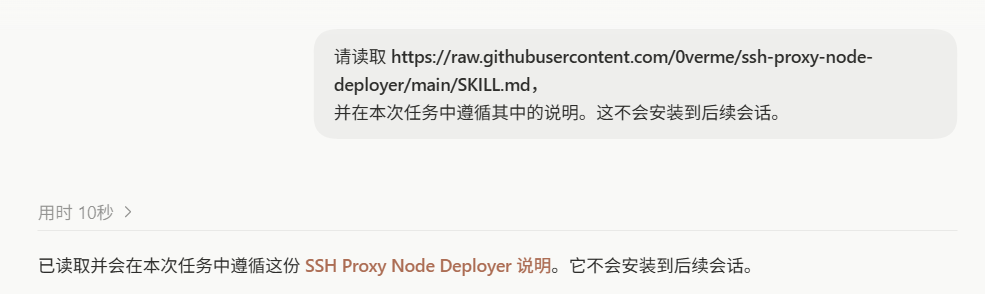
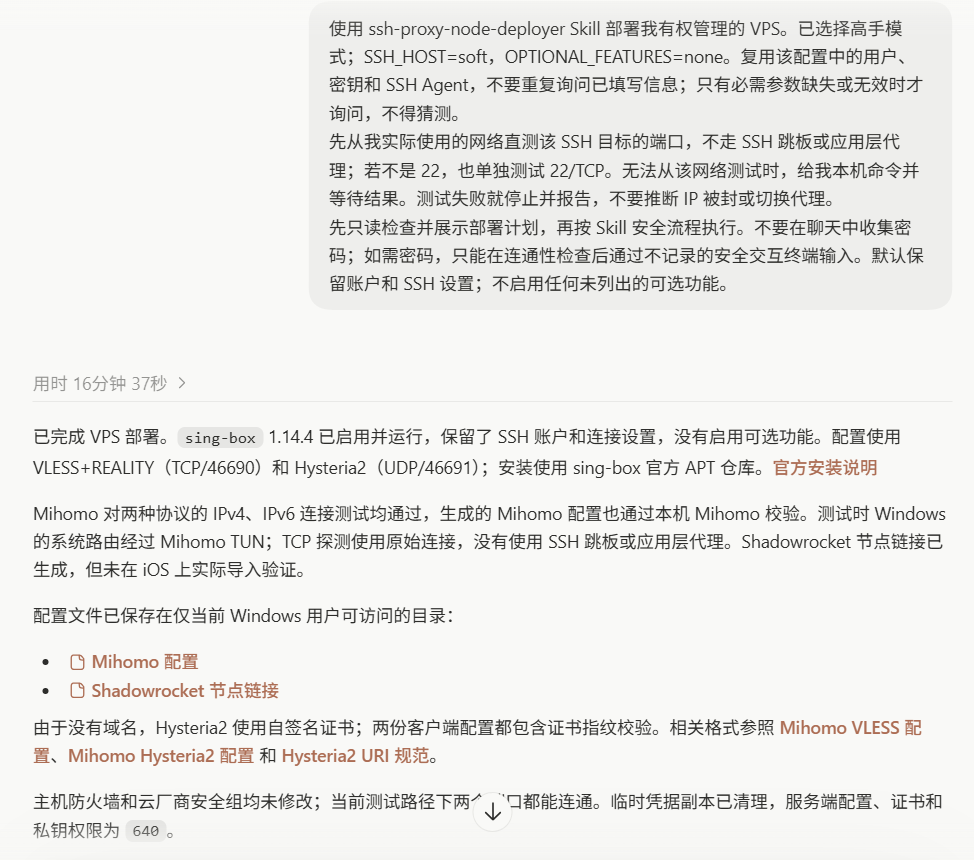
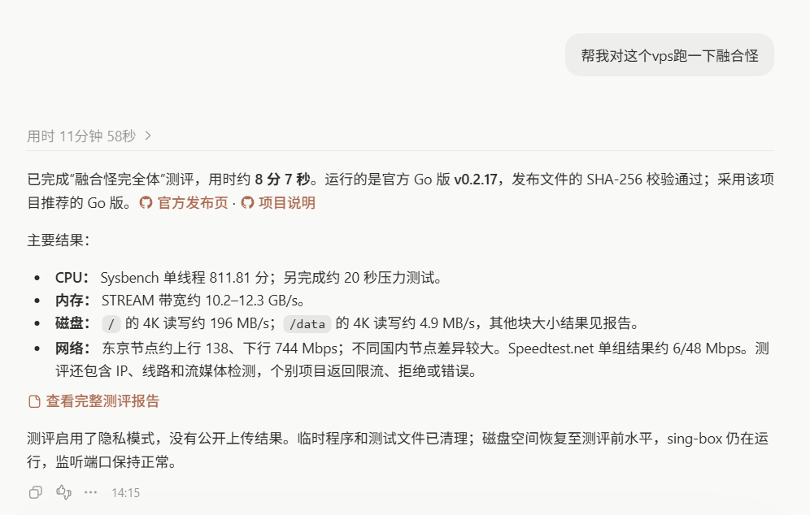

<div align="center">

# SSH Proxy Node Deployer

**让 AI Agent 通过 SSH，为你检查并部署一台自用的 sing-box 节点。**  
**Let an AI agent inspect and deploy a personal sing-box node over SSH.**

[中文](#中文) · [English](#english) · [安全说明](#安全说明--security) · [License](#license)


</div>

## 中文

这是一个面向 AI Agent 的可复用 Skill。给 Agent 提供一台你有权管理的 Linux VPS 的 SSH 登录方式后，它会先检查系统、网络、端口和现有服务，再按需部署并生成客户端配置。它不绑定云厂商，也不依赖此前的聊天记录。

它提供一套谨慎的默认方案，不是一个盲目执行的安装脚本：关键步骤会根据服务器现状决定；遇到可能覆盖现有服务、系统不受支持或访问安全无法保证时，会先停下来说明情况。

### 默认行为

- 使用 sing-box，部署 VLESS + REALITY + Vision（TCP）和 Hysteria2（UDP）。
- 全新安装默认使用 REALITY `443/TCP` 和 Hysteria2 `443/UDP`；高手模式可明确选择 `ports-high`，使用 `46690/TCP` 和 `46691/UDP`。TCP、UDP 分别检查；任何所选端口冲突时停止整个双协议部署，不自动更换端口。
- 部署前从实际使用的客户端网络直测 SSH `22/TCP`（或你指定的 SSH 端口），不走 SSH 跳板或应用层代理。失败只说明当前测试位置无法直连，不能单凭一次失败断定 IP 被封；会先停止部署并报告可能原因，不会自动换 IP 或切换代理。
- 按实际可达性判断 IPv4 / IPv6；有地址不代表从公网一定能连通。
- 有域名且你能控制 DNS 时，默认尝试申请受信任的 ACME 证书；否则用新生成的自签证书，并说明客户端验证身份的取舍。
- 问答时询问你使用的客户端（可多选），只生成相应且受支持的配置格式；客户端文件保存在仓库之外的私有目录。
- 默认保留现有 SSH 访问路径、主机防火墙策略和其他服务；新手模式仅在初始 SSH 用户为 `root` 时创建或安全复用 `vps`，非 root 用户直接复用；高手模式优先复用已验证的非 root 管理员。高手模式若初始登录为 `root` 且没有可独立验证的非 root 管理员，会询问创建自定义用户名、指定已有账号验证或暂停；新账号必须先展示计划并获得单独明确确认。不会默认禁用 root SSH、启用 SSH 密码认证或重启机器。sing-box API / Dashboard 和第三方面板默认关闭。
- **默认不下载、不运行融合怪。** 只有高手模式明确要求测速或机器评测时才运行；新手模式始终跳过。完整测试可能增加 CPU、磁盘负载和流量。

443 是常见 HTTPS/HTTP3 端口，在某些网络中可能更兼容，但不保证连接成功，也不保证无法识别或封锁。高位端口不能隐藏服务器 IP，也挡不住全端口扫描。请结合云厂商安全组、防火墙和账户安全设置使用。

部署前只读检查 TCP、UDP 的监听服务、绑定地址、IPv4/IPv6 和通配监听，以及可识别的容器端口映射与转发规则。TCP/443 上的 HTTPS 网站或 UDP/443 上的 HTTP/3 服务可能分别冲突；任一所选端口冲突或无法确认可用时，停止整个双协议部署，报告原因和选择，不停止或覆盖已有服务。新手可选择暂停，或明确切换高手模式再选择 `ports-high`；不确认或取消时不写入。云安全组无法仅凭 SSH 确认，需分别核实并从外部验收。

新默认值仅适用于确认是全新安装的节点。重复运行、维护已有节点、发现已有 sing-box inbound 或无法确认安装归属时，不套用新默认端口，不自动修改节点端口、客户端配置、防火墙、证书或凭据。`ports-443` 不构成迁移授权；端口迁移必须单独明确请求并确认计划。

现有 ACME 条件和回退策略不变：HTTP-01 检查 TCP/80，TLS-ALPN-01 检查 TCP/443；REALITY 占用 TCP/443 时不能假设后者可用，Hysteria2 使用 UDP/443 也不代表 TCP/443 可用。不为签证书停止已有服务，不用关闭证书验证掩盖问题；无法确定安全处理时暂停。

如果 Agent 不在你实际使用的网络中，可在本机先测 SSH 端口（替换服务器 IP；自定义 SSH 端口时替换 `22`）：

```powershell
Test-NetConnection -ComputerName "SERVER_IP" -Port 22 -InformationLevel Detailed
```

macOS / Linux 可用：

```bash
nc -vz -w 5 SERVER_IP 22
```

这只检查当前网络到该 TCP 端口是否可达，不验证 SSH 用户名/密钥，也不能单独证明 IP 被封。

### SSH 预检查：TCP、认证与 Agent 分开

高手模式按顺序分别检查原始 TCP 直连和 SSH 认证。先按现有 SSH Host 配置中的目标主机与端口做原始 TCP 测试；自定义端口使用配置端口，只有你特别询问 `22` 时才额外测 `22`。TCP 探测不经过 `ProxyJump`，认证成功也不能代替直连检查；若原始 TCP 检查按上述安全策略失败，就停止部署并分别报告结果。

TCP 检查通过后，先运行：

```powershell
ssh -o BatchMode=yes -o ConnectTimeout=10 YOUR_SSH_HOST "whoami && hostname"
```

将 `YOUR_SSH_HOST` 替换为已有的 SSH Config `Host` 别名。OpenSSH 会按现有配置使用 `IdentityFile`、证书、可用的 SSH Agent 或系统默认密钥；配置了 `ProxyJump` 时，此 SSH 认证命令仍按配置连接。非交互认证成功即可继续，Agent 停止或不可用不能单独阻断流程。

认证失败时，分别报告连接超时、Host Key 验证异常、`Permission denied` 或其他错误，然后停止；不要自动改 SSH 配置、接受未知指纹、关闭 Host Key 检查或尝试绕过认证。Agent 状态只是可选诊断，不得自动启动或设为必需条件。不要输出、复制或上传私钥和密码。`ProxyJump` 下认证成功仍不代表目标主机的原始 TCP 直连成功。

完整的复现步骤和验收矩阵见[SSH 预检查验收用例](tests/ssh-preflight-acceptance.md)。

### 首次安装

通常只需安装一次；后续调用方式由 Agent 平台决定。

**通用安装提示词**

```text
请从公开 GitHub 仓库 https://github.com/0verme/ssh-proxy-node-deployer 安装名为 ssh-proxy-node-deployer 的 Skill。
入口文件在仓库根目录的 SKILL.md。请使用当前 Agent 平台支持的标准安装方式，
并告诉我之后如何调用。如果平台不支持持久安装，请读取该文件并只在当前任务中遵循，
不要声称已经为后续会话安装。如果已存在同名 Skill，先告诉我更新方式，不要覆盖。
```

**只在当前任务使用，不做持久安装**

```text
请读取 https://raw.githubusercontent.com/0verme/ssh-proxy-node-deployer/main/SKILL.md，
并在本次任务中遵循其中的说明。这不会安装到后续会话。
```

<details>
<summary>Codex 安装与手动备用方式（可选）</summary>

**Codex 快捷方式**

```text
$skill-installer 请从 0verme/ssh-proxy-node-deployer 仓库根目录安装 Skill，入口文件为 SKILL.md，名称为 ssh-proxy-node-deployer。如果同名 Skill 已存在，先告诉我更新方式，不要覆盖。
```

Codex 手动安装备用方式：

Windows PowerShell：

```powershell
$skills = Join-Path $HOME ".codex\skills"
New-Item -ItemType Directory -Force $skills | Out-Null
git clone https://github.com/0verme/ssh-proxy-node-deployer.git (Join-Path $skills "ssh-proxy-node-deployer")
```

macOS / Linux：

```bash
mkdir -p ~/.codex/skills
git clone https://github.com/0verme/ssh-proxy-node-deployer.git ~/.codex/skills/ssh-proxy-node-deployer
```

其他平台的持久安装目录和调用方式不同，请使用其标准 Skill 安装功能或配置的 Skills 目录。安装后可能需要重新加载 Agent。

</details>

### 快速使用 / 给 Agent 的提示词

复制一种模式，把占位符替换成实际值后发送。Agent 应直接使用已填写的信息；只有必需参数缺失或无效时才询问，不得猜测。
`CLIENT` 可填写 Shadowrocket、Clash Verge / Mihomo、sing-box、v2rayN 或其他客户端名称。

**新手模式**（填写服务器 IP、SSH 用户名、端口和客户端）：

```text
使用 ssh-proxy-node-deployer Skill 部署我有权管理的 VPS。已选择新手模式；直接使用以下参数，不要重复询问已填写项，缺失或无效时才询问，不得猜测：
SERVER_IP=<服务器 IP>
SSH_USER=<初始 SSH 用户名>
SSH_PORT=<SSH 端口，例如 22>
CLIENT=<客户端名称>

先从我实际使用的网络直测指定 SSH 端口，不走 SSH 跳板或应用层代理；只有我另行要求时才单独测试 22/TCP。无法从该网络测试时，给我本机命令并等待结果；测试失败就停止并报告，不要推断 IP 被封或切换代理。
先只读检查并展示部署计划，再按 Skill 安全流程执行。密码不得出现在聊天中；通过连通性检查后，如需密码，只能使用不记录的安全交互终端，无法安全输入时让我通过安全 TTY 输入。
只用新手模式默认功能，不询问或启用高级选项；客户端配置保存到仓库外的私有目录。
```

**高手模式**（填写已有 SSH Config Host 别名；root-only 时可初始化自定义管理员）：

```text
使用 ssh-proxy-node-deployer Skill 部署我有权管理的 VPS。已选择高手模式；SSH_HOST=<现有 SSH Config 中的 Host 别名>，OPTIONAL_FEATURES=none。复用该配置中的用户、IdentityFile、可用的 SSH Agent 或系统默认密钥；Agent 不是必需条件。不要重复询问已填写信息；只有必需参数缺失或无效时才询问，不得猜测。
先从我实际使用的网络直测该 SSH 目标的端口，不走 SSH 跳板或应用层代理；只有我另行要求时才单独测试 22/TCP。无法从该网络测试时，给我本机命令并等待结果。测试失败就停止并报告，不要推断 IP 被封或切换代理。
先记录初始 SSH 登录身份并完成只读审计。若当前为 root 且没有已配置并可独立验证的非 root 管理员，主动询问：创建管理员（推荐）、指定并验证已有管理员、或暂停。创建时允许我输入用户名；展示账号、至少 24 字符自动生成密码（仅通过安全无记录 TTY 设置和交付，不展示在聊天）、专用 Ed25519 密钥、需密码 sudo、SSH 别名以及保留 root 登录的计划，并等待我单独确认后才写入。取消或未确认时不改账号、不部署。复用现有账号时不覆盖凭据或策略。
不要在聊天中收集密码；如安全 TTY 不能设置并交付自动生成的密码，让我通过安全 TTY 自行设置，否则停止。保持原 root 会话可用，通过独立 SSH 连接先验证新账号密钥身份，再检查 `sudo -l`、清除 sudo 缓存并交互验证需密码的 `sudo -v`。两项验证成功后才用新管理员继续部署。默认不启用 SSH 密码认证、不禁用 root SSH；不启用任何未列出的可选功能。
```

<details>
<summary>详细说明：账户处理与完整安全操作流程</summary>

以下内容说明两种模式的账户策略和完整安全流程；快速使用时无需复制这部分。

开始部署前，Agent 会先问你：

```text
你想用哪种方式连接服务器？
1. 新手模式：按初始 SSH 用户身份创建/复用 `vps` 或复用当前用户，并部署默认节点。
2. 高手模式：复用现有 SSH；如果只有 root 登录，可选择初始化非 root 管理员或暂停，并自定义高级选项。
```

然后按所选模式继续：

- **新手模式：**提供服务器地址、初始 SSH 用户名和端口。账户分支只看最初登录身份，即使之后使用 `sudo` 或 `su` 也不改变判断。为本次部署明确选择新手模式，仅授权其已说明的 `root` → `vps` 默认初始化；仅有 root 登录或仅提出部署请求不代表授权账号写入。初始用户为 `root` 时，先只读检查系统、SSH、用户和 sudo 配置并展示计划；`vps` 不存在才创建，已存在则审计并原样复用；若现有认证或 sudo 不可用、有冲突，就停止报告，不覆盖密码、密钥、用户组或设置。仅为新建的 `vps` 安全生成至少 24 字符随机密码并通过不记录的安全 TTY 设置和交付，配置专用 Ed25519 公钥及需密码验证的 sudo。保持原 root 登录可用，并从独立 SSH 会话验证 `vps` 登录和 sudo。初始用户不是 `root`（如 `ubuntu`、`debian`、`overme` 或 `vps`）时，直接复用原用户，不创建 `vps`，不改用户名、密码、密钥、用户组或 SSH 策略，只检查所需 sudo 权限。新手模式使用默认节点功能，不询问高级参数。
- **高手模式：**提供已有 SSH Host 别名或目标，默认复用当前 SSH 用户、认证和账户设置；OpenSSH 按现有配置使用 IdentityFile、证书、可用的 SSH Agent 或系统默认密钥，Agent 停止不构成阻断条件。优先复用能独立验证 SSH 密钥登录和需密码 sudo 的非 root 管理员。若初始 SSH 用户是 `root` 且没有可用的非 root 管理员，Agent 会主动让你选择：创建新管理员（推荐）、指定并验证现有管理员，或暂停部署。创建时你可以指定用户名（例如 `vps`），Agent 必须先完成用户名校验、展示账号与安全配置计划，再等待单独明确确认；未确认或取消时不创建、不改 SSH 配置、不部署。新账号密码由密码学安全随机源生成，至少 24 字符，仅通过安全无记录 TTY 设置和交付；无法安全设置和交付时改由你通过安全 TTY 自行设置，否则停止。SSH 使用专用 Ed25519 密钥，sudo 需密码。复用已有账号时不覆盖密码、密钥、组或 sudo 策略；不满足条件可重新选择账号或暂停。高手模式可自定义 SSH 主机/端口/别名/密钥和账号策略；默认不启用 SSH 密码认证或禁用 root SSH。

root-only 时，账号选择示例：

```text
检测到当前 SSH 登录用户：root
未发现已配置且可独立验证的非 root SSH 管理员。
请选择：
1. 创建新的管理员账号（推荐）
2. 指定并验证已有管理员账号
3. 暂停部署
```

选择创建后，Agent 校验用户名（拒绝空值、Shell 特殊字符、选项注入、保留或冲突账号），先展示计划再等待你的单独确认。计划说明新建账号用户名、自动生成且至少 24 字符的密码如何通过安全 TTY 设置和交付、专用 Ed25519 密钥、本地 SSH 别名（`HostName`、`User`、`Port`、`IdentityFile`、`IdentitiesOnly yes`）、需密码 sudo，以及保持 root SSH 和 sshd 密码认证策略不变。密码本身不得显示在聊天或普通文件中。首次写入前必须确认可用安全 TTY；如果没有，就停止且不创建账号。取消/未确认也不产生变更；账号已存在则只审计和安全复用，不改其密码、密钥、组或 sudo 策略。

Agent 默认通过非 root 账户执行远程操作，并按需使用 sudo；root 初始登录的新手流程只在检查和初始化期间使用 root，验证 `vps` 后切换到 `vps`。

**不要把密码粘贴到聊天里。**如果终端不能安全设置并交付随机密码，就由你通过安全 TTY 自行设置；如果没有安全交互终端，停止账户初始化，不要把密码转移到聊天、命令参数或日志。

新手和高手模式都会在生成配置前询问你使用什么客户端，可多选：Shadowrocket、Clash Verge / Mihomo、sing-box、v2rayN 或其他客户端。如果不确定，告诉 Agent 你的设备系统，让它根据当前兼容性推荐并等你确认。

```text
使用 ssh-proxy-node-deployer Skill，在我有权管理的 VPS 上部署自用节点。
开始前先问我选择“新手模式”或“高手模式”；如果我已经选过，就不要重复问。
选择后只询问该模式需要的连接信息：新手模式询问服务器地址、用户名和 SSH 端口；高手模式询问已有 SSH Host 别名或目标。
生成客户端配置前，询问我使用什么客户端（可多选：Shadowrocket、Clash Verge / Mihomo、sing-box、v2rayN 或其他客户端）。如果我不确定，先问设备系统，核实兼容性后给我建议并等待确认；只生成我选择的客户端格式。
在任何密码输入前，从我实际使用的客户端网络直测指定的 SSH 端口（默认 22/TCP），不走 SSH 跳板或应用层代理；只有我另行要求时才单独测试 22/TCP。如果你无法从我的客户端网络测试，先给我本机测试命令并等待结果。测试失败时不要直接说 IP 被封，先停止部署并报告原因，不要自动切换代理或更换 IP。
新手模式：分支依据必须是初始 SSH 登录用户名，记录后不得用 sudo/su 后的身份重新判断。初始用户为 root 时，先只读检查 SSH、账户和 sudo 环境并报告计划；不存在 vps 才创建普通管理用户，已存在则审计并原样复用其现有认证和 sudo；现有访问或权限缺失、有冲突时停止报告，不覆盖已有设置。仅为新建的 vps 安全生成至少 24 字符随机密码，供本地账户认证和 sudo 使用（SSH 使用专用密钥），通过不记录的安全 TTY 设置和交付；若做不到，要求我在安全 TTY 自行设置。仅为新建的 vps 配置专用 Ed25519 密钥，私钥保存在本机 `~/.ssh/ssh-proxy-node-deployer/` 并限制权限；只向服务器追加公钥，不覆盖 authorized_keys 或本地文件；新增不冲突的 `~/.ssh/config` 别名，包含主机、vps 用户、端口、密钥路径和 `IdentitiesOnly yes`，保留原条目。配置需密码的 sudo，禁止 NOPASSWD: ALL。保持 root 会话打开，通过独立 SSH 会话验证 vps 公钥登录和 sudo 后再部署。初始用户不是 root 时，原样复用 ubuntu、debian、overme、vps 等当前用户，不创建 vps、不改用户、密码、密钥、用户组或 SSH 设置，只检查 sudo；权限不足则报告并停止。
高手模式：默认复用我提供的 SSH Host、用户、IdentityFile、可用的 SSH Agent、系统默认密钥和账户策略；Agent 不是必需条件。先单独做原始 TCP 直连测试，再运行 `ssh -o BatchMode=yes -o ConnectTimeout=10 <Host> "whoami && hostname"` 验证非交互认证。认证成功即通过认证预检；失败时区分超时、Host Key 异常、Permission denied 和其他错误并停止，不自动改配置或接受未知指纹。优先使用已有非 root 管理员。若初始 SSH 身份为 root 且没有可独立验证的非 root 管理员，主动询问创建账号（允许我指定用户名）、指定并验证已有账号、或暂停。创建前展示完整计划并等待单独确认；新账号密码至少 24 字符且仅通过安全无记录 TTY 设置和交付，SSH 使用专用 Ed25519 密钥，sudo 必须需要密码。已有账号只审计复用，不覆盖密码、密钥、用户组或 sudo 策略。取消不写入、不部署。可自定义 SSH 连接、账号策略和节点高级功能。
只有高手模式询问高级设置；新手模式只用默认基础功能。默认不启用可选项、不运行融合怪、不安装面板。

严格按顺序执行：连接验证 → 只读检查 → 展示计划 → 必要的账户初始化 → 独立 SSH / sudo 验证 → 节点部署 → 最终验收。不得运行未经审查的远程一键安装脚本，也不得将远程内容直接管道给 Shell；保留现有 SSH 和防火墙策略。任何 SSH 配置变更都要先做语法检查并准备已验证的恢复与回滚路径。禁用 Root SSH 登录必须经过明确确认和备用管理员独立验证；永不删除 root 系统账户，也不盲目修改防火墙。全新安装使用双 443；任一端口冲突则停止，不自动更换，已有节点不自动迁移。
客户端配置请放在仓库外的私有目录，不要把密码或私钥写入聊天、仓库或日志。
```

</details>

### 模式行为与验收场景

| 场景 | 预期行为 / 验收点 |
| --- | --- |
| T01 高手 + root-only | 只读审计后询问创建、指定并验证已有管理员或暂停；不得直接默认停止或写入。 |
| T02 输入新用户名 `vps` | 校验用户名，展示完整创建计划，等待单独明确确认；确认前没有写操作。 |
| T03 用户取消 | 不创建账号、不改本地 SSH/密钥配置、不继续部署。 |
| T04 自动生成密码 | 新账号密码由安全随机源生成且至少 24 字符；仅安全无记录 TTY 设置和交付，不进入聊天、日志或参数。 |
| T05 安全终端不可用 | 引导用户通过安全 TTY 自行设置；没有安全 TTY 时停止初始化。 |
| T06 `vps` 已存在 | 审计后仅在现有独立 SSH 密钥登录和需密码 sudo 均通过时复用；不覆盖凭据、密钥、组或 sudo 策略。 |
| T07 用户名非法 | 拒绝空值、非法格式、选项注入和保留/冲突账号；不执行写操作。 |
| T08 新用户 SSH 验证失败 | 停止部署，保持原 root SSH 会话和访问，不自动删除新账号。 |
| T09 新用户 sudo 验证失败 | 停止部署，保留 root 访问并报告已发生的变更。 |
| T10 新用户 SSH 与 sudo 都通过 | 独立登录、身份、`sudo -l` 和清缓存后的需密码 `sudo -v` 全部通过后，切换新账号部署。 |
| T11 重复执行 Skill | 不重复创建账号、密钥、公钥行、别名、组成员或 sudo 规则；冲突时停止并报告。 |
| T12 高手 + 已有非 root 管理员 | 保留配置并复用经独立 SSH 与 sudo 验证通过的账号。 |
| T13 新手 + 初始用户 `root` | 仍按默认 `vps` 规则创建或审计复用。 |
| T14 新手 + 初始用户非 root | 复用初始用户，不创建其他账号或改其凭据/SSH 配置。 |
| T15 用户请求禁用 root SSH | 仍需单独明确授权、备用管理员独立验证、恢复路径和回滚。 |
| T16 Agent 未运行但密钥认证成功 | Agent 仅作可选诊断；现有认证成功不得被 Agent 状态阻断。 |
| T17 TCP 可达但 SSH 认证失败 | 不进入任何账号变更；报告认证错误并停止。 |
| T18 本地 SSH 别名或密钥路径冲突 | 不覆盖现有文件或 Host 条目；报告冲突并允许重新选择或暂停。 |

如果希望先检查而不部署，可以这样说：

```text
使用 ssh-proxy-node-deployer 检查这台 VPS 是否适合部署。先只读检查并给我报告，
暂时不要安装软件、修改配置或防火墙。
```

### 可选功能

下表是高手模式的选项。新手模式不会询问这些功能，也不会启用它们；如果想用高级功能，请在连接模式问题中选择高手模式。高手模式下可以回答“无”以使用默认配置。

可以直接说中文功能名，也可以使用下表的功能码。复制下面的格式，并只保留你需要的项目：

```text
可选项：sing-box-dashboard, protocol-anytls
```

省略“可选项”或写 `可选项：无`，表示使用默认功能，不启用任何额外功能。Agent 只启用列出的项目；不认识的功能码或描述不清的范围会先向你确认。功能码不会跳过安全检查。

| 功能码 | 启用内容 | 注意事项 |
| --- | --- | --- |
| `ports-high` | 全新安装选择 REALITY TCP/46690、Hysteria2 UDP/46691 | 必须明确选择；任一端口冲突时停止，不自动换端口。 |
| `ports-443` | 全新安装双 443 默认方案的兼容别名 | 不授权迁移已有节点；与 `ports-high` 同时选择时停止并要求明确选择。 |
| `domain-endpoint` | 自有域名作为授权的客户端连接地址 | 仅高手模式显式选择；先检查 DNS 和连通性，不改变握手目标。 |
| `reality-nearby-target` | 被动发现并评估邻近握手目标 | 用户选择并确认；不扫描整个网段。 |
| `reality-custom-target` | 用户指定握手目标 | 与邻近目标互斥，检查并确认后才变更。 |
| `fusion-basic` | 融合怪基础检查 | 轻量、限时并关闭上传和重负载测试；运行前会告知基础 IP 查询可能把 VPS 公网 IP 发送给第三方。 |
| `fusion-full` | 融合怪完整评测 | 会产生 CPU / 磁盘负载和额外流量。 |
| `firewall-ufw` / `firewall-firewalld` | 配置对应的主机防火墙 | 先检查现有规则并确保 SSH 不会被锁在外面；不会盲目替换现有防火墙。 |
| `ssh-hardening` | SSH 加固，例如禁用密码登录 | 先验证备用管理员登录并准备回滚；未说明具体改动时会先确认。 |
| `protocol-anytls` / `protocol-tuic` / `protocol-shadowsocks` / `protocol-other` | 添加对应协议 | 使用 `protocol-other` 时需同时写明协议名称。 |
| `multi-user` / `traffic-accounting` | 多用户凭据 / 流量或配额统计 | 统计方式可能有存储和准确性限制，部署前会说明。 |
| `warp` | 配置 WARP | 先检查系统兼容性及路由影响。 |
| `bbr-fq` / `swap` / `udp-buffer-tuning` | BBR/fq、交换空间 / UDP 缓冲区调优 | 检查兼容性和系统影响后再修改。 |
| `sing-box-dashboard` | sing-box 官方 Dashboard（1.14.0+） | 先检查资源；低配机器默认不启用。使用强 API 密钥、本机监听和 SSH 隧道。直接公网开放需要单独明确要求、TLS 和严格网络限制。详见 [sing-box 官方 API 文档](https://sing-box.sagernet.org/configuration/service/api/)。 |
| `third-party-panel` | 第三方面板 | 请同时写出面板名称；先检查资源、安装来源和访问安全。 |
| `private-subscription` | 私有 HTTPS 订阅 | 需保持访问受控，不放入公开仓库或网页。 |
| `qr-code` | 客户端配置二维码 | 二维码包含连接凭据，按私密配置文件同等保护。 |

#### 高手模式：域名入口与 REALITY 目标

仅高手模式明确选择 `domain-endpoint` 才将自有域名用作授权的客户端连接地址；新手模式不询问或启用这些高级功能，`OPTIONAL_FEATURES=none` 也不启用。不提供域名仍可部署；仅提供域名不等于启用 REALITY 自有域名入口。域名入口不会自动启用 `reality-nearby-target` 或 `reality-custom-target`。节点连接域名、REALITY SNI/握手目标与 Hysteria2 证书域名是不同用途；新手模式原有 ACME 触发和回退规则不变。

`reality-nearby-target` 按 `same-asn`、`same-prefix24`（仅 IPv4）或 `auto` 从公开被动数据寻找候选，最多展示 5 个并进行低频 TLS 检查，不扫描整个网段。`reality-custom-target` 使用用户指定的握手目标。两者互斥；域名入口可与其中之一及 `ports-high` 组合。检查 DNS、TLS 1.3、HTTP/2、证书、SNI、重定向、CDN 和回环风险；同 ASN 或网段不能证明可靠性。没有合适候选时保持原配置；用户明确选择后，展示计划并单独确认。现有节点不会自动迁移，也不会自动修改 DNS 或防火墙。

示例（逻辑问答参数，并非环境变量解析器）：

```ini
OPTIONAL_FEATURES=domain-endpoint,reality-nearby-target
ENDPOINT_DOMAIN=node.example.com
REALITY_TARGET_MODE=nearby
REALITY_NEARBY_SCOPE=auto
```

### 图片与实际测试

上方的 SVG 仅为部署流程示意。以下截图来自实际使用 Skill 的会话，展示当时可见的操作和回复；其中部署、客户端检查及性能结果是该会话的报告，本次 README 更新未独立重跑 VPS、客户端或基准测试。

<p align="center"></p>

<p align="center"><em>1. 读取并在当前任务中遵循仓库的 SKILL.md；截图明确说明未安装到后续会话。</em></p>

<p align="center"></p>

<p align="center"><em>2. 高手模式部署记录：截图中的回复报告 sing-box 部署完成、Mihomo IPv4/IPv6 连通测试与本机配置校验通过；Shadowrocket 链接已生成，但未在 iOS 导入验证。</em></p>

<p align="center"></p>

<p align="center"><em>3. 融合怪完整性能测试记录：回复报告运行约 8 分 7 秒，并列出 CPU、内存、磁盘和网络指标；具体数值见图。</em></p>

### 适用范围

- 目标是你拥有或明确获准管理的 Linux VPS。
- Agent 需要能够使用 SSH，并在必要时安全地交互式输入凭据。
- 服务器能访问 sing-box 官方软件源；IPv4、IPv6 和云安全组情况因服务商与实例而异。
- 当前 Skill 是 Agent 执行指南，不是独立的一键安装程序，也不保证任何网络环境都可连接。

## English

This is a reusable Skill for AI agents. Give your agent SSH access to a Linux VPS you own or are authorized to administer. It inspects the operating system, network, ports, and existing services before making changes, then deploys a personal node and creates client profiles as appropriate. It is provider-independent and does not rely on previous chat history.

This is a cautious operating guide, not a blind installer. The agent adapts to the host and pauses when it finds an unsafe conflict, an unsupported system, or a change that could jeopardize access.

### Defaults

- sing-box with VLESS + REALITY + Vision over TCP and Hysteria2 over UDP.
- New installations default to REALITY on `443/TCP` and Hysteria2 on `443/UDP`. Expert mode can explicitly select `ports-high` for `46690/TCP` and `46691/UDP`. Check TCP and UDP separately; a conflict on either selected port stops the entire dual-protocol deployment without automatic replacement.
- Before deployment, test SSH TCP/22 (or the configured SSH port) directly from the actual client network, without an SSH jump host or application proxy. Separately, in Expert mode, first try `ssh -o BatchMode=yes -o ConnectTimeout=10 <Host> "whoami && hostname"` using the existing SSH Host configuration. OpenSSH may use IdentityFile, the Agent when available, default keys, and configured ProxyJump for authentication; a stopped Agent is not a blocker when authentication succeeds. TCP success does not prove authentication, and authentication through ProxyJump does not prove direct TCP reachability. A failure only shows that the current test location cannot connect; it does not prove the IP is banned. Stop and report likely causes instead of switching proxies or replacing the IP automatically.
- Detect IPv4 and IPv6 based on actual reachability; an assigned address alone does not prove public connectivity.
- If you provide a domain and control its DNS, try to obtain a trusted ACME certificate by default. Otherwise, create a fresh self-signed certificate and explain the client identity-verification trade-off.
- Ask which client app(s) the user uses; generate only the corresponding supported profile format(s). Keep client files in a private directory outside the repository.
- Preserve existing SSH paths, host firewall policy, and unrelated services. In Beginner mode, create or safely reuse `vps` only when the original SSH login user is `root`; otherwise reuse the original account. Expert mode reuses a verified non-root administrator when available. If the initial login is `root` with no independently verifiable non-root SSH administrator, ask whether to create a custom-name administrator, specify and verify an existing account, or pause. Creating requires a validated username, a displayed plan, and separate explicit confirmation. Keep root SSH and the existing sshd password-authentication policy unchanged by default; never enable SSH password authentication as part of account setup. Do not reboot the VPS; keep the sing-box API / Dashboard and third-party panels disabled by default.
- **Fusion Monster is off by default.** Run it only when explicitly requested in Expert mode; Beginner mode always skips it. A full benchmark can use CPU, disk, and network bandwidth.

Port 443 is common for HTTPS/HTTP3 and may improve compatibility on some networks, but does not guarantee connectivity or prevent identification or blocking. High ports do not hide the VPS IP or prevent full-range scans. Use cloud firewall rules and sound account security as well.

Before any writes, inspect TCP and UDP listeners, services, binding addresses, IPv4/IPv6 and wildcard overlap, plus identifiable container port mappings and forwarding rules. An HTTPS website on TCP/443 or HTTP/3 service on UDP/443 can conflict independently. If either selected port conflicts or cannot be established as available, stop the entire dual-protocol deployment and report the evidence and choices; do not stop or overwrite existing services. A Beginner may pause or explicitly switch to Expert mode and select `ports-high`; cancellation or lack of explicit plan confirmation means no writes. SSH alone cannot verify cloud security groups: check each required rule and validate externally.

The new defaults apply only to a confirmed new installation. On a repeat run, maintenance, an existing sing-box inbound, or an installation of unclear ownership, do not apply the new defaults or automatically change node ports, client files, firewall rules, certificates, or credentials. `ports-443` does not authorize migration; port migration requires a separate explicit request and confirmed plan.

Existing ACME triggers and fallback remain unchanged: check TCP/80 for HTTP-01 and TCP/443 for TLS-ALPN-01. REALITY using TCP/443 does not mean the latter challenge can use it, and Hysteria2 on UDP/443 does not make TCP/443 available. Do not stop existing services for certificate issuance or disable certificate verification to hide a problem; pause if a safe outcome is unclear.

If your agent is not running on the network you will use, test the SSH port locally (replace the server IP and use your custom SSH port instead of `22` when applicable):

```powershell
Test-NetConnection -ComputerName "SERVER_IP" -Port 22 -InformationLevel Detailed
```

On macOS / Linux:

```bash
nc -vz -w 5 SERVER_IP 22
```

This only tests whether the current network can reach the TCP port; it does not validate SSH credentials or prove the IP is banned.

### SSH preflight: keep TCP, authentication, and Agent checks separate

In Expert mode, check raw TCP reachability and SSH authentication as separate steps. First test the target host and port from the existing SSH Host configuration; use its custom port, and test port 22 separately only when specifically requested. The raw TCP probe does not use `ProxyJump`. SSH authentication success cannot replace the direct-connect check; if raw TCP fails under the safety policy above, stop deployment and report both results separately.

After TCP passes, first run:

```powershell
ssh -o BatchMode=yes -o ConnectTimeout=10 YOUR_SSH_HOST "whoami && hostname"
```

Replace `YOUR_SSH_HOST` with the existing OpenSSH Config `Host` alias. OpenSSH uses its configured `IdentityFile`, certificates, available SSH Agent, or standard default keys. If configured, `ProxyJump` remains active for this SSH authentication command. A successful non-interactive login passes the authentication check; a stopped or unavailable Agent is not a blocker.

On failure, distinguish timeout, host-key verification errors, `Permission denied`, and other errors, then stop. Do not edit SSH configuration, accept an unknown fingerprint, disable host-key checking, or bypass authentication automatically. Agent status is optional diagnostic information and must never be made a prerequisite. Never print, copy, or upload private keys or passwords. Authentication through `ProxyJump` still does not prove direct TCP reachability to the target.

See the [SSH preflight acceptance cases](tests/ssh-preflight-acceptance.md) for reproducible steps and the acceptance matrix.

### Account initialization

Beginner mode keeps its fixed policy: the user's explicit choice of Beginner mode for this deployment authorizes only the documented `root` → `vps` bootstrap. A root login or deployment request alone does not authorize account changes. When the initial SSH login is `root`, create or audit/reuse `vps`; otherwise reuse the exact initial non-root account without changing it. Expert mode preserves current SSH settings and reuses an already configured non-root administrator only after independent key-login and password-required sudo checks; a separately confirmed new account may add its own non-conflicting SSH alias.

When Expert mode starts as `root` and the read-only audit finds no usable non-root SSH administrator, the agent asks:

```text
Detected SSH login user: root
No configured and independently verifiable non-root SSH administrator was found.
Choose:
1. Create a new administrator (recommended)
2. Specify and verify an existing administrator
3. Pause deployment
```

For a new account, you choose the username. The agent validates it against Linux login-name rules, reserved/system users, UID policy, and existing accounts before using it as a separate command argument. It then shows a plan for the username, a cryptographically generated password of at least 24 characters, dedicated Ed25519 key, local SSH alias, password-required sudo, and preservation of root SSH access. It waits for your separate confirmation before the first write. Cancelling or declining means no account/config changes and no deployment.

The password is for local account authentication and sudo; SSH uses the key, and the existing sshd password-authentication policy remains unchanged. Set and deliver the generated password only through a secure, non-recording TTY. Before the first write, confirm a safe TTY is available; otherwise stop without account/config changes. If the generated password cannot be delivered safely, let the user set it through a secure TTY. Never place the password in chat, command arguments, environment variables, scripts, shell history, logs, or ordinary files. For an account that already exists, inspect and reuse it only if a fresh independent key login and password-required sudo pass; do not overwrite its password, keys, groups, or sudo policy. If checks fail, reselect an account or pause.

Keep the original root SSH session open. Verify a truly separate SSH connection as the selected username before elevation, inspect `sudo -l`, clear the sudo cache, and verify `sudo -v` through the secure interactive prompt. Only after both independent checks pass may deployment continue as the non-root administrator. A failed SSH or sudo check stops deployment and leaves the root access path intact.

### First-time setup

You usually install the Skill once. The persistent install location and invocation syntax depend on your agent platform.

**Generic installation prompt**

```text
Install the Skill named ssh-proxy-node-deployer from the public GitHub repository
https://github.com/0verme/ssh-proxy-node-deployer. Its entrypoint is SKILL.md at the
repository root. Use the standard installation method for this agent platform and
tell me how to invoke it later. If persistent installation is unsupported, read the
file and follow it for this task only; do not claim it is installed for future
sessions. If a Skill with that name already exists, tell me how to update it and
do not overwrite it.
```

**Use for this task only, without persistent installation**

```text
Read https://raw.githubusercontent.com/0verme/ssh-proxy-node-deployer/main/SKILL.md
and follow it for this task. This does not install the Skill for future sessions.
```

<details>
<summary>Optional Codex installation and manual fallback</summary>

**Codex shortcut**

```text
$skill-installer Install the Skill from the root of 0verme/ssh-proxy-node-deployer.
Its entrypoint is SKILL.md and its name is ssh-proxy-node-deployer. If that Skill
already exists, tell me how to update it; do not overwrite it.
```

Codex manual fallback:

```bash
mkdir -p ~/.codex/skills
git clone https://github.com/0verme/ssh-proxy-node-deployer.git ~/.codex/skills/ssh-proxy-node-deployer
```

On Windows, clone into `%USERPROFILE%\.codex\skills\ssh-proxy-node-deployer`. Other platforms use their configured Skills directory and invocation syntax. Reload the agent if needed.

</details>

### Quick start / Prompt your agent

Copy one mode and replace its placeholders with real values. The agent must use completed values without asking again; it should ask only for required values that are missing or invalid and must not guess.
For `CLIENT`, use Shadowrocket, Clash Verge / Mihomo, sing-box, v2rayN, or another named client app.

**Beginner mode** (fill in the server IP, SSH username, port, and client app):

```text
Use the ssh-proxy-node-deployer Skill to deploy a VPS I own or am authorized to administer. Beginner mode is selected; use the parameters below without asking again for completed values. Ask only when a required value is missing or invalid; do not guess:
SERVER_IP=<server IP>
SSH_USER=<initial SSH username>
SSH_PORT=<SSH port, for example 22>
CLIENT=<client app>

First test the specified SSH port directly from the network I will use, without an SSH jump host or application proxy; test TCP/22 separately only when I specifically ask. If you cannot test from that network, give me a local command and wait for the result. If the test fails, stop and report it; do not infer that the IP is banned or switch proxies.
Perform read-only checks and show the deployment plan first, then follow the Skill's safety process. Never put passwords in chat. After reachability is checked, enter a password only through a non-recording secure interactive terminal; if safe entry is unavailable, ask me to enter it through a secure TTY.
Use Beginner defaults only: do not ask about or enable advanced options. Save client files in a private directory outside the repository.
```

**Expert mode** (fill in an existing SSH Config Host alias):

```text
Use the ssh-proxy-node-deployer Skill to deploy a VPS I own or am authorized to administer. Expert mode is selected; SSH_HOST=<Host alias from my existing SSH Config>, OPTIONAL_FEATURES=none. Reuse its configured user, IdentityFile, SSH Agent when available, and standard default keys; the Agent is optional. Do not ask again for completed values; ask only for required values that are missing or invalid, and do not guess.
First test the SSH target's port directly from the network I will use, without an SSH jump host or application proxy; test TCP/22 separately only when I specifically ask. If you cannot test from that network, give me a local command and wait for the result. If the test fails, stop and report it; do not infer that the IP is banned or switch proxies.
Perform the read-only audit first. If the initial SSH identity is root and no independently verified non-root administrator exists, ask whether I want to create a new administrator (let me choose the username), specify an existing administrator for verification, or pause. Show the full account plan and wait for my separate confirmation before any write. Generate a password of at least 24 characters and set/deliver it only through a secure, non-recording TTY; if that channel is unavailable, guide me to set it through a secure TTY or stop. Use a dedicated Ed25519 key and password-required sudo. Preserve an existing account's credentials and policy. Keep root access open and verify the account through an independent SSH login and password-required sudo before deployment. Do not enable SSH password authentication or disable root SSH by default. Do not enable unlisted optional features.
```

<details>
<summary>Detailed explanation: account handling and full safety workflow</summary>

The following section explains each mode's account policy and complete safety workflow. You do not need to copy it for a quick start.

Provide the SSH host, initial username, and port. **Do not paste a password into chat.** Keep the original login identity as the account-selection basis, even if a later command uses `sudo` or `su`.

The agent first asks:

```text
Which connection mode do you want?
1. Beginner mode: create/reuse `vps` only for an initial root login; otherwise reuse the initial user, then deploy defaults.
2. Expert mode: reuse existing SSH; if only root access is available, choose whether to create or specify/verify a non-root administrator, or pause, then customize advanced options.
```

Then it follows the selected mode and asks which client app(s) you use before generating files. You can choose more than one: Shadowrocket, Clash Verge / Mihomo, sing-box, v2rayN, or another named client. If you are unsure, tell the agent your device operating system so it can check compatibility, recommend an option, and wait for your confirmation.

- **Beginner mode:** provide the server address, initial SSH username, and port. The initial login identity controls the account branch, even after `sudo` or `su`. If it is `root`, the agent audits the host and creates `vps` only when absent; an existing `vps` is reused with its current working authentication and sudo, without overwriting settings, and missing access or conflicts stop the run. Only a new `vps` gets a cryptographically random password of at least 24 characters through a non-recording secure terminal, a dedicated Ed25519 SSH key, and password-required sudo. A fresh independent SSH session must verify key login and sudo before deployment. If the initial user is not root, reuse that exact account without creating `vps` or changing its name, password, keys, groups, or SSH policy; check sudo and stop if it is insufficient. Beginner mode uses defaults and asks no advanced questions.
- **Expert mode:** provide an existing SSH Host alias or configured target. Reuse the current SSH user, IdentityFile, SSH Agent when available, standard default keys, and account policy by default; a stopped Agent is not a blocker when another configured method succeeds. Prefer a non-root administrator whose independent key login and password-required sudo pass. If the initial SSH login is `root` and no such administrator exists, ask whether to create an administrator (recommended), specify and verify an existing account, or pause. The user may choose a username. Validate it, display the exact account/key/sudo/SSH-alias plan, and require separate confirmation before the first write. A new account gets a cryptographically generated password of at least 24 characters, set and delivered only through a secure non-recording TTY, a dedicated Ed25519 key, and password-required sudo. If secure password handling is unavailable, have the user set it through a secure TTY or stop. Keep the original root session open; do not change existing-account credentials or policy. Expert mode supports custom SSH host/port/alias/key and account strategy plus node/network features.

The agent runs remote work as a non-root user and uses `sudo` only for needed system commands. A root connection is used only for read-only checks and an explicitly confirmed account bootstrap; after independent SSH and sudo checks pass, switch to the selected administrator.

Never paste passwords into chat. If a terminal cannot securely set and deliver the generated password, set it yourself through a secure TTY; without a secure interactive terminal, stop account initialization. SSH must be verified from a genuinely separate connection as the selected username before any sudo. Then check `sudo -l`, clear its cache, and verify password-required `sudo -v` before deploying.

### Mode behavior and acceptance scenarios

| ID | Scenario | Expected behavior / acceptance check |
| --- | --- | --- |
| T01 | Expert + root-only | Ask whether to create, specify/verify an existing administrator, or pause; do not stop by default. |
| T02 | Custom username `vps` | Validate it, show the complete plan, and wait for explicit confirmation before any write. |
| T03 | User cancels | No account or local SSH changes and no deployment. |
| T04 | Generated password | At least 24 characters from a cryptographic source; set/deliver only through a secure non-recording TTY. |
| T05 | No secure terminal | Guide the user to set a password through a secure TTY or stop; never disclose it through chat/files. |
| T06 | `vps` already exists | Audit and reuse only if independent SSH key login and password-required sudo pass; do not overwrite credentials or policy. |
| T07 | Invalid username | Reject empty, invalid, injected, reserved, or conflicting names without writes. |
| T08 | New SSH verification fails | Stop deployment and preserve root SSH access; do not automatically delete the new account. |
| T09 | New sudo verification fails | Stop deployment, preserve root access, and report changes already made. |
| T10 | SSH and sudo both pass | Continue deployment as the verified non-root administrator. |
| T11 | Repeated run | Do not duplicate accounts, keys, public-key lines, aliases, group memberships, or sudo rules. |
| T12 | Existing non-root admin | Reuse only after independent SSH and sudo verification; preserve its settings. |
| T13 | Beginner + initial root | Retain the fixed `vps` create/reuse policy. |
| T14 | Beginner + initial non-root | Reuse that user; do not create another account or alter its credentials/SSH. |
| T15 | User asks to disable root SSH | Require separate authorization, verified alternate admin, recovery path, and rollback. |
| T16 | Agent stopped, key login succeeds | Agent state does not block a successful configured SSH authentication method. |
| T17 | TCP reachable, SSH authentication fails | Do not begin account changes; report the authentication failure and stop. |
| T18 | Local alias/key path conflict | Do not overwrite existing files or Host entries; report the conflict. |

```text
Use the ssh-proxy-node-deployer Skill to deploy a personal node on a VPS I own
or am authorized to administer.
First ask me to choose Beginner mode or Expert mode, unless I already chose.
After I choose, ask only for that mode's connection details: server address,
username, and SSH port for Beginner mode; existing SSH Host alias or target for Expert mode.
Before generating client files, ask which client app(s) I use. I may choose
multiple: Shadowrocket, Clash Verge / Mihomo, sing-box, v2rayN, or another named
client. If I am unsure, ask my device operating system, check current compatibility,
recommend an option, and wait for my confirmation. Generate only the selected formats.
Before any password entry, test the configured SSH port directly from the client
network I will use, without an SSH jump host or application proxy. If the configured
port is not 22, test TCP/22 separately only when I specifically ask. If you cannot test from that network, give
me a local command and wait. If it fails, report that it is unreachable from this
test location, stop, and do not automatically switch proxy or IP.
Beginner mode: choose account handling from the initial SSH login identity
before any `sudo` or `su`. If it is `root`, inspect SSH/users/sudo first, then
create `vps` only if absent or audit and safely reuse its current working
authentication and sudo. Stop on conflicts without changing existing settings.
Only for a new `vps`, set and deliver a cryptographically random password of
at least 24 characters through a non-recording secure terminal (or ask me to set
it through a secure TTY if safe delivery is unavailable), install a dedicated
Ed25519 key with its private file protected locally, append only the public key,
and add a unique SSH config alias with host, user, port, key path, and
`IdentitiesOnly yes`. Grant password-required sudo. The password is for local
account authentication and sudo; SSH uses the key. Verify a fresh key login and sudo through an independent SSH session
while keeping the original root session open. If the initial user is not root,
reuse that exact user; do not create `vps` or modify its username, password,
keys, groups, or SSH policy. Check sudo and stop if insufficient. Never use
`NOPASSWD: ALL`. Beginner mode uses default node features only.
Expert mode: reuse the configured SSH Host, user, IdentityFile, SSH Agent when available, standard default keys, and existing
account policy by default. Prefer an existing non-root administrator after independent SSH-key and password-required sudo checks. If
the initial user is root and no verified non-root administrator exists, ask whether I want to create a new administrator, specify and verify
an existing account, or pause. Let me choose the username; validate it against Linux account rules and local reserved/existing accounts.
For a new account, show the full plan and wait for my separate explicit confirmation before any write. Generate a password of at least 24
characters; set/deliver it only through a secure, non-recording TTY (otherwise guide me to set it through a secure TTY or stop). Configure
a dedicated Ed25519 key, password-required sudo, and a conflict-free SSH alias. Keep the original root session and SSH access available.
For existing accounts, do not overwrite credentials, keys, groups, or sudo policy.
Ask about advanced settings only in Expert mode. Beginner mode uses defaults
only. Keep add-ons, Fusion Monster, and panels off by default; enable them only
if I choose Expert mode and explicitly request them.

Follow this order: verify the connection → perform read-only checks → show the
plan → initialize an account only after explicit confirmation → verify its SSH login and password-required sudo in
an independent session → deploy as the verified non-root account → perform final acceptance. Preserve
existing SSH and firewall paths. Do not execute an unreviewed remote one-click
installer or pipe remote content directly to a shell. Check `sshd` syntax and prepare a verified
recovery path and rollback before any requested SSH change. Disabling root SSH
login requires explicit confirmation and an independently verified alternate
administrator. Never delete the root system account or blindly modify a firewall.
For a confirmed new installation use the default TCP/443 and UDP/443 profile; stop on either conflict without automatic replacement, and do not automatically migrate an existing node. Make reversible changes.
Save client profiles in a private directory outside the repository. Never put
passwords or private keys in chat, the repository, or logs.
```

To inspect without deploying:

```text
Use ssh-proxy-node-deployer to assess whether this VPS is suitable. Perform
read-only checks and report your findings. Do not install software or change
configuration or firewall rules yet.
```

</details>

### Optional features

This table is for Expert mode. Beginner mode uses the basic defaults and is not asked about these options. In Expert mode, answer `none` to keep the defaults.

You can name a feature in plain language or copy its ID from the table below. For example:

```text
Optional features: sing-box-dashboard, protocol-anytls
```

Omit this line or write `Optional features: none` to keep the default profile without add-ons. The agent enables only the listed features. Unknown IDs or unclear scope require clarification; IDs do not bypass safety checks.

| Feature ID | Enables | Notes |
| --- | --- | --- |
| `ports-high` | Select REALITY TCP/46690 and Hysteria2 UDP/46691 for a new installation | Explicit selection required; stop on either conflict without automatic replacement. |
| `ports-443` | Compatibility alias for the new-installation dual-443 default | Does not authorize migration of existing nodes; selecting it with `ports-high` stops and requires an explicit choice. |
| `domain-endpoint` | User-controlled domain for authorized client connection addresses | Explicit Expert selection; check DNS and reachability without changing the handshake target. |
| `reality-nearby-target` | Passively discover and assess nearby handshake targets | User selection and confirmation required; no whole-subnet scan. |
| `reality-custom-target` | User-specified handshake target | Mutually exclusive with nearby discovery; check and confirm before changes. |
| `fusion-basic` | Basic Fusion Monster check | Time-limited, with uploads and heavy suites disabled. Basic IP lookups may send the VPS public IP to third parties; the agent will tell you before running it. |
| `fusion-full` | Full Fusion Monster benchmark | Adds CPU/disk load and network traffic. |
| `firewall-ufw` / `firewall-firewalld` | Configure the named host firewall | Check existing rules and preserve SSH access; do not blindly replace an existing firewall. |
| `ssh-hardening` | SSH hardening, such as disabling password login | Test alternate administrator access and prepare rollback first; clarify unspecified changes. |
| `protocol-anytls` / `protocol-tuic` / `protocol-shadowsocks` / `protocol-other` | Add the named protocol | Name the protocol when using `protocol-other`. |
| `multi-user` / `traffic-accounting` | Multiple user credentials / traffic or quota tracking | Explain storage and accuracy limits before choosing an accounting method. |
| `warp` | Configure WARP | Check system compatibility and routing impact first. |
| `bbr-fq` / `swap` / `udp-buffer-tuning` | BBR/fq, swap, or UDP buffer tuning | Check compatibility and system-wide effects before changes. |
| `sing-box-dashboard` | Official sing-box Dashboard (1.14.0+) | Check resources; keep it off on low-resource hosts by default. Use a strong API secret, loopback binding, and SSH tunnel. Direct public exposure needs a separate explicit request, TLS, and strict network restrictions. See the [official API documentation](https://sing-box.sagernet.org/configuration/service/api/). |
| `third-party-panel` | A third-party panel | Name the panel; check resources, installation source, and access security first. |
| `private-subscription` | Private HTTPS subscription | Keep access controlled and out of public repositories and pages. |
| `qr-code` | Client configuration QR codes | QR codes contain credentials; protect them like private client files. |

#### Expert mode: domain endpoint and REALITY target

Only explicit Expert mode selection of `domain-endpoint` uses a user-controlled domain for authorized client connection addresses. Beginner mode does not ask about or enable these advanced features, and `OPTIONAL_FEATURES=none` enables none of them. Deployment works without an owned domain; providing a domain alone does not enable a REALITY domain endpoint. `domain-endpoint` does not automatically enable `reality-nearby-target` or `reality-custom-target`. The connection domain, REALITY SNI/handshake target, and Hysteria2 certificate domain have distinct purposes; the existing beginner ACME trigger and fallback remain unchanged.

`reality-nearby-target` uses passive public evidence with `same-asn`, `same-prefix24` (IPv4 only), or `auto`, displays at most five candidates, and performs low-frequency TLS checks without scanning an entire subnet. `reality-custom-target` uses a user-specified handshake target. The two target features are mutually exclusive; the domain endpoint can be combined with either and with `ports-high`. Check DNS, TLS 1.3, HTTP/2, certificates, SNI, redirects, CDN and loop risks; shared ASN or prefix does not establish reliability. If no candidate qualifies, preserve the configuration. After explicit selection, show the plan and obtain separate confirmation. Existing nodes are not automatically migrated; DNS and firewall rules are not automatically changed.

Example (logical Q&A parameters, not an environment-variable parser):

```ini
OPTIONAL_FEATURES=domain-endpoint,reality-nearby-target
ENDPOINT_DOMAIN=node.example.com
REALITY_TARGET_MODE=nearby
REALITY_NEARBY_SCOPE=auto
```

### Screenshots and real-world validation

The SVG above is a workflow illustration. The screenshots below were captured during actual use of the Skill. They show the visible steps and the assistant's reports; this README update did not independently rerun the VPS, client checks, or benchmark.

<p align="center"></p>

<p align="center"><em>1. The repository's SKILL.md was read and followed for the current task; the screenshot says it was not installed for future sessions.</em></p>

<p align="center"></p>

<p align="center"><em>2. Expert-mode deployment report: the assistant reports sing-box deployment and successful Mihomo IPv4/IPv6 connectivity and local profile checks. A Shadowrocket link was generated but not imported on iOS.</em></p>

<p align="center"></p>

<p align="center"><em>3. Fusion Monster full benchmark report: the assistant reports a run of about 8 minutes 7 seconds and lists CPU, memory, disk, and network results; see the image for reported figures.</em></p>

### Scope

- For Linux VPS instances you own or are explicitly authorized to administer.
- The agent must be able to use SSH and, when needed, obtain credentials through a secure interactive prompt.
- The host must be able to reach the official sing-box package source. IPv4, IPv6, and cloud firewall behavior varies by provider and instance.
- This repository contains agent instructions, not a standalone one-click installer. No network can be guaranteed to work in every environment.

## 安全说明 / Security

仅在你拥有或明确获准管理的服务器上使用。请在提交前检查提示词、日志和生成文件，确认没有 SSH 密码、私钥、UUID、订阅链接、真实 IP 或其他凭据。客户端配置属于私密凭据，不应公开上传。发现安全问题时，请通过 GitHub 私下联系维护者，不要在公开 Issue 中发布可利用的服务器信息。

Use this only on servers you own or are authorized to administer. Before sharing logs or opening an issue, remove SSH passwords, private keys, UUIDs, subscription links, real IP addresses, and other credentials. Client profiles are secrets and must not be published. Report security issues privately through GitHub rather than posting exploitable server details in a public issue.

## License

MIT. See [LICENSE](LICENSE).

