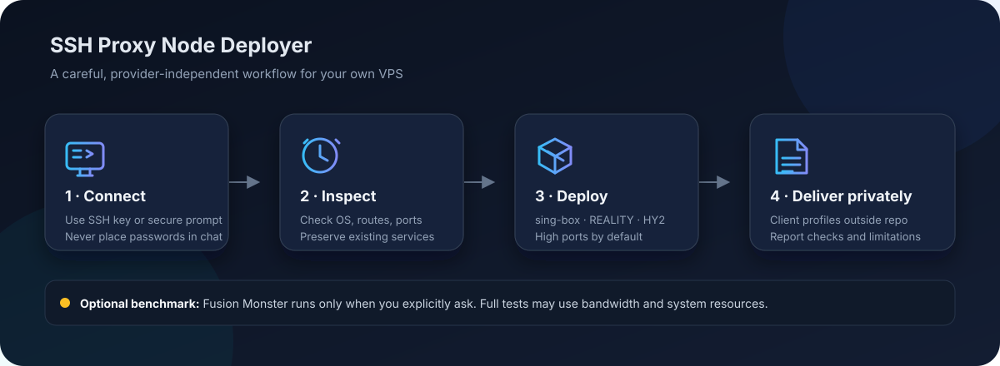

<div align="center">

# SSH Proxy Node Deployer

**让 AI Agent 通过 SSH，为你检查并部署一台自用的 sing-box 节点。**  
**Let an AI agent inspect and deploy a personal sing-box node over SSH.**

[中文](#中文) · [English](#english) · [安全说明](#安全说明--security) · [License](#license)



</div>

## 中文

这是一个面向 AI Agent 的可复用 Skill。给 Agent 提供一台你有权管理的 Linux VPS 的 SSH 登录方式后，它会先检查系统、网络、端口和现有服务，再按需部署并生成客户端配置。它不绑定云厂商，也不依赖此前的聊天记录。

它提供一套谨慎的默认方案，不是一个盲目执行的安装脚本：关键步骤会根据服务器现状决定；遇到可能覆盖现有服务、系统不受支持或访问安全无法保证时，会先停下来说明情况。

### 默认行为

- 使用 sing-box，部署 VLESS + REALITY + Vision（TCP）和 Hysteria2（UDP）。
- 默认使用高位端口：REALITY `46690/TCP`，Hysteria2 `46691/UDP`。如端口冲突，只为冲突的协议选择其他可用高位端口。`443` 是兼容选项，不是默认端口。
- 部署前从实际使用的客户端网络直测 SSH `22/TCP`（或你指定的 SSH 端口），不走 SSH 跳板或应用层代理。失败只说明当前测试位置无法直连，不能单凭一次失败断定 IP 被封；会先停止部署并报告可能原因，不会自动换 IP 或切换代理。
- 按实际可达性判断 IPv4 / IPv6；有地址不代表从公网一定能连通。
- 有域名且你能控制 DNS 时，默认尝试申请受信任的 ACME 证书；否则用新生成的自签证书，并说明客户端验证身份的取舍。
- 问答时询问你使用的客户端（可多选），只生成相应且受支持的配置格式；客户端文件保存在仓库之外的私有目录。
- 默认保留现有 SSH 访问路径、主机防火墙策略和其他服务；新手模式仅在初始 SSH 用户为 `root` 时创建或安全复用 `vps`，非 root 用户直接复用；高手模式默认不改账户。不会重启整台机器。sing-box API / Dashboard 和第三方面板默认关闭。
- **默认不下载、不运行融合怪。** 只有高手模式明确要求测速或机器评测时才运行；新手模式始终跳过。完整测试可能增加 CPU、磁盘负载和流量。

高位端口只能减少部分只扫描常见端口的噪声，不能隐藏服务器 IP，也挡不住全端口扫描。请结合云厂商安全组、防火墙和账户安全设置使用。

如果 Agent 不在你实际使用的网络中，可在本机先测 SSH 端口（替换服务器 IP；自定义 SSH 端口时替换 `22`）：

```powershell
Test-NetConnection -ComputerName "SERVER_IP" -Port 22 -InformationLevel Detailed
```

macOS / Linux 可用：

```bash
nc -vz -w 5 SERVER_IP 22
```

这只检查当前网络到该 TCP 端口是否可达，不验证 SSH 用户名/密钥，也不能单独证明 IP 被封。

### SSH 预检查：TCP、认证与 Agent 分开

高手模式按顺序分别检查原始 TCP 直连和 SSH 认证。先按现有 SSH Host 配置中的目标主机与端口做原始 TCP 测试；自定义端口使用配置端口，只有你特别询问 `22` 时才额外测 `22`。TCP 探测不经过 `ProxyJump`，认证成功也不能代替直连检查；若原始 TCP 检查按上述安全策略失败，就停止部署并分别报告结果。

TCP 检查通过后，先运行：

```powershell
ssh -o BatchMode=yes -o ConnectTimeout=10 YOUR_SSH_HOST "whoami && hostname"
```

将 `YOUR_SSH_HOST` 替换为已有的 SSH Config `Host` 别名。OpenSSH 会按现有配置使用 `IdentityFile`、证书、可用的 SSH Agent 或系统默认密钥；配置了 `ProxyJump` 时，此 SSH 认证命令仍按配置连接。非交互认证成功即可继续，Agent 停止或不可用不能单独阻断流程。

认证失败时，分别报告连接超时、Host Key 验证异常、`Permission denied` 或其他错误，然后停止；不要自动改 SSH 配置、接受未知指纹、关闭 Host Key 检查或尝试绕过认证。Agent 状态只是可选诊断，不得自动启动或设为必需条件。不要输出、复制或上传私钥和密码。`ProxyJump` 下认证成功仍不代表目标主机的原始 TCP 直连成功。

完整的复现步骤和验收矩阵见[SSH 预检查验收用例](tests/ssh-preflight-acceptance.md)。

### 首次安装

通常只需安装一次；后续调用方式由 Agent 平台决定。

**通用安装提示词**

```text
请从公开 GitHub 仓库 https://github.com/0verme/ssh-proxy-node-deployer 安装名为 ssh-proxy-node-deployer 的 Skill。
入口文件在仓库根目录的 SKILL.md。请使用当前 Agent 平台支持的标准安装方式，
并告诉我之后如何调用。如果平台不支持持久安装，请读取该文件并只在当前任务中遵循，
不要声称已经为后续会话安装。如果已存在同名 Skill，先告诉我更新方式，不要覆盖。
```

**只在当前任务使用，不做持久安装**

```text
请读取 https://raw.githubusercontent.com/0verme/ssh-proxy-node-deployer/main/SKILL.md，
并在本次任务中遵循其中的说明。这不会安装到后续会话。
```

<details>
<summary>Codex 安装与手动备用方式（可选）</summary>

**Codex 快捷方式**

```text
$skill-installer 请从 0verme/ssh-proxy-node-deployer 仓库根目录安装 Skill，入口文件为 SKILL.md，名称为 ssh-proxy-node-deployer。如果同名 Skill 已存在，先告诉我更新方式，不要覆盖。
```

Codex 手动安装备用方式：

Windows PowerShell：

```powershell
$skills = Join-Path $HOME ".codex\skills"
New-Item -ItemType Directory -Force $skills | Out-Null
git clone https://github.com/0verme/ssh-proxy-node-deployer.git (Join-Path $skills "ssh-proxy-node-deployer")
```

macOS / Linux：

```bash
mkdir -p ~/.codex/skills
git clone https://github.com/0verme/ssh-proxy-node-deployer.git ~/.codex/skills/ssh-proxy-node-deployer
```

其他平台的持久安装目录和调用方式不同，请使用其标准 Skill 安装功能或配置的 Skills 目录。安装后可能需要重新加载 Agent。

</details>

### 快速使用 / 给 Agent 的提示词

复制一种模式，把占位符替换成实际值后发送。Agent 应直接使用已填写的信息；只有必需参数缺失或无效时才询问，不得猜测。
`CLIENT` 可填写 Shadowrocket、Clash Verge / Mihomo、sing-box、v2rayN 或其他客户端名称。

**新手模式**（填写服务器 IP、SSH 用户名、端口和客户端）：

```text
使用 ssh-proxy-node-deployer Skill 部署我有权管理的 VPS。已选择新手模式；直接使用以下参数，不要重复询问已填写项，缺失或无效时才询问，不得猜测：
SERVER_IP=<服务器 IP>
SSH_USER=<初始 SSH 用户名>
SSH_PORT=<SSH 端口，例如 22>
CLIENT=<客户端名称>

先从我实际使用的网络直测指定 SSH 端口，不走 SSH 跳板或应用层代理；只有我另行要求时才单独测试 22/TCP。无法从该网络测试时，给我本机命令并等待结果；测试失败就停止并报告，不要推断 IP 被封或切换代理。
先只读检查并展示部署计划，再按 Skill 安全流程执行。密码不得出现在聊天中；通过连通性检查后，如需密码，只能使用不记录的安全交互终端，无法安全输入时让我通过安全 TTY 输入。
只用新手模式默认功能，不询问或启用高级选项；客户端配置保存到仓库外的私有目录。
```

**高手模式**（填写已有 SSH Config Host 别名）：

```text
使用 ssh-proxy-node-deployer Skill 部署我有权管理的 VPS。已选择高手模式；SSH_HOST=<现有 SSH Config 中的 Host 别名>，OPTIONAL_FEATURES=none。复用该配置中的用户、IdentityFile、可用的 SSH Agent 或系统默认密钥；Agent 不是必需条件。不要重复询问已填写信息；只有必需参数缺失或无效时才询问，不得猜测。
先从我实际使用的网络直测该 SSH 目标的端口，不走 SSH 跳板或应用层代理；只有我另行要求时才单独测试 22/TCP。无法从该网络测试时，给我本机命令并等待结果。测试失败就停止并报告，不要推断 IP 被封或切换代理。
先只读检查并展示部署计划，再按 Skill 安全流程执行。不要在聊天中收集密码；如需密码，只能在连通性检查后通过不记录的安全交互终端输入。默认保留账户和 SSH 设置；不启用任何未列出的可选功能。
```

<details>
<summary>详细说明：账户处理与完整安全操作流程</summary>

以下内容说明两种模式的账户策略和完整安全流程；快速使用时无需复制这部分。

开始部署前，Agent 会先问你：

```text
你想用哪种方式连接服务器？
1. 新手模式：按初始 SSH 用户身份创建/复用 `vps` 或复用当前用户，并部署默认节点。
2. 高手模式：我已经配置好 SSH，请直接复用。
```

然后按所选模式继续：

- **新手模式：**提供服务器地址、初始 SSH 用户名和端口。账户分支只看最初登录身份，即使之后使用 `sudo` 或 `su` 也不改变判断。初始用户为 `root` 时，先只读检查系统、SSH、用户和 sudo 配置；`vps` 不存在才创建，已存在则审计并原样复用；若现有认证或 sudo 不可用、有冲突，就停止报告，不覆盖密码、密钥、用户组或设置。仅为新建的 `vps` 安全生成至少 24 字符随机密码并通过不记录的安全 TTY 设置和交付，配置专用 Ed25519 公钥及需密码验证的 sudo。保持原 root 登录可用，并从独立 SSH 会话验证 `vps` 登录和 sudo。初始用户不是 `root`（如 `ubuntu`、`debian`、`overme` 或 `vps`）时，直接复用原用户，不创建 `vps`，不改用户名、密码、密钥、用户组或 SSH 策略，只检查所需 sudo 权限。新手模式使用默认节点功能，不询问高级参数。
- **高手模式：**提供已有 SSH Host 别名或目标，默认复用当前 SSH 用户、认证和账户设置；OpenSSH 按现有配置使用 IdentityFile、证书、可用的 SSH Agent 或系统默认密钥，Agent 停止不构成阻断条件。优先使用已有非 root 操作用户，不会默默创建账户。如果只有 root 登录且没有已配置的非 root 用户，就报告所需权限并停止，除非你明确要求以 root 操作并提供可验证的恢复方案。高手模式可自定义 SSH 主机/端口/别名/密钥、管理用户名及账户创建策略、sudo/root SSH 策略、SSH 密码认证，以及 REALITY、Hysteria2 和其他协议、监听端口、IPv4/IPv6、防火墙、域名/TLS、WARP、BBR、融合怪和面板；未明确提出账户改动时保持现状。

Agent 默认通过非 root 账户执行远程操作，并按需使用 sudo；root 初始登录的新手流程只在检查和初始化期间使用 root，验证 `vps` 后切换到 `vps`。

**不要把密码粘贴到聊天里。**如果终端不能安全设置并交付随机密码，就由你通过安全 TTY 自行设置；如果没有安全交互终端，停止账户初始化，不要把密码转移到聊天、命令参数或日志。

新手和高手模式都会在生成配置前询问你使用什么客户端，可多选：Shadowrocket、Clash Verge / Mihomo、sing-box、v2rayN 或其他客户端。如果不确定，告诉 Agent 你的设备系统，让它根据当前兼容性推荐并等你确认。

```text
使用 ssh-proxy-node-deployer Skill，在我有权管理的 VPS 上部署自用节点。
开始前先问我选择“新手模式”或“高手模式”；如果我已经选过，就不要重复问。
选择后只询问该模式需要的连接信息：新手模式询问服务器地址、用户名和 SSH 端口；高手模式询问已有 SSH Host 别名或目标。
生成客户端配置前，询问我使用什么客户端（可多选：Shadowrocket、Clash Verge / Mihomo、sing-box、v2rayN 或其他客户端）。如果我不确定，先问设备系统，核实兼容性后给我建议并等待确认；只生成我选择的客户端格式。
在任何密码输入前，从我实际使用的客户端网络直测指定的 SSH 端口（默认 22/TCP），不走 SSH 跳板或应用层代理；只有我另行要求时才单独测试 22/TCP。如果你无法从我的客户端网络测试，先给我本机测试命令并等待结果。测试失败时不要直接说 IP 被封，先停止部署并报告原因，不要自动切换代理或更换 IP。
新手模式：分支依据必须是初始 SSH 登录用户名，记录后不得用 sudo/su 后的身份重新判断。初始用户为 root 时，先只读检查 SSH、账户和 sudo 环境并报告计划；不存在 vps 才创建普通管理用户，已存在则审计并原样复用其现有认证和 sudo；现有访问或权限缺失、有冲突时停止报告，不覆盖已有设置。仅为新建的 vps 安全生成至少 24 字符随机密码，供本地账户认证和 sudo 使用（SSH 使用专用密钥），通过不记录的安全 TTY 设置和交付；若做不到，要求我在安全 TTY 自行设置。仅为新建的 vps 配置专用 Ed25519 密钥，私钥保存在本机 `~/.ssh/ssh-proxy-node-deployer/` 并限制权限；只向服务器追加公钥，不覆盖 authorized_keys 或本地文件；新增不冲突的 `~/.ssh/config` 别名，包含主机、vps 用户、端口、密钥路径和 `IdentitiesOnly yes`，保留原条目。配置需密码的 sudo，禁止 NOPASSWD: ALL。保持 root 会话打开，通过独立 SSH 会话验证 vps 公钥登录和 sudo 后再部署。初始用户不是 root 时，原样复用 ubuntu、debian、overme、vps 等当前用户，不创建 vps、不改用户、密码、密钥、用户组或 SSH 设置，只检查 sudo；权限不足则报告并停止。
高手模式：默认复用我提供的 SSH Host、用户、IdentityFile、可用的 SSH Agent、系统默认密钥和账户策略；Agent 不是必需条件。先单独做原始 TCP 直连测试，再运行 `ssh -o BatchMode=yes -o ConnectTimeout=10 <Host> "whoami && hostname"` 验证非交互认证。认证成功即通过认证预检；失败时区分超时、Host Key 异常、Permission denied 和其他错误并停止，不自动改配置或接受未知指纹。优先使用已有非 root 操作用户，不会默默创建账户。只有我明确要求时才创建或修改指定账户；可自定义 SSH 连接、账户创建策略、sudo/root 登录、密码认证和节点高级功能。
只有高手模式询问高级设置；新手模式只用默认基础功能。默认不启用可选项、不运行融合怪、不安装面板。

严格按顺序执行：连接验证 → 只读检查 → 展示计划 → 必要的账户初始化 → 独立 SSH / sudo 验证 → 节点部署 → 最终验收。不得运行未经审查的远程一键安装脚本，也不得将远程内容直接管道给 Shell；保留现有 SSH 和防火墙策略。任何 SSH 配置变更都要先做语法检查并准备已验证的恢复与回滚路径。禁用 Root SSH 登录必须经过明确确认和备用管理员独立验证；永不删除 root 系统账户，也不盲目修改防火墙。按默认方案使用高位端口。
客户端配置请放在仓库外的私有目录，不要把密码或私钥写入聊天、仓库或日志。
```

</details>

### 模式行为与验收场景

| 场景 | 预期行为 / 验收点 |
| --- | --- |
| 新手 + 初始用户 `root`，首次部署 | 只读检查后创建普通用户 `vps`；密码至少 24 字符并由安全 TTY 设置和交付；专用 Ed25519 公钥登录及需密码的 sudo 经独立会话验证后才部署。 |
| 新手 + 初始用户 `root`，`vps` 已存在 | 审计账户、密钥和 sudo 状态；不覆盖现有密码、密钥、组或配置；冲突时停止。 |
| 新手 + `ubuntu` / `debian` 等非 root 用户 | 复用初始用户；不创建 `vps`，不改凭据或 SSH；检查当前 sudo。 |
| 新手 + 普通用户没有 sudo | 报告所需权限并停止，不提权、不新建账户。 |
| 新手 + SSH 密钥登录失败 | 停止，不创建账户、不改 sshd 或防火墙；保留现有会话并报告认证失败。 |
| 新手 + sudo 验证失败 | 停止部署，不撤销原访问；报告缺少或失败的 sudo 权限。 |
| 高手 + 复用已有用户 | 保留现有用户、认证和账户策略。 |
| 高手 + 明确要求自定义用户 | 先报告具体账户改动；执行相同的备份、独立验证与回滚要求。 |
| 重复运行 Skill | 不重复创建用户/密钥/SSH 配置，不覆盖已有服务；检查现状后只做缺失且已计划的变更。 |

如果希望先检查而不部署，可以这样说：

```text
使用 ssh-proxy-node-deployer 检查这台 VPS 是否适合部署。先只读检查并给我报告，
暂时不要安装软件、修改配置或防火墙。
```

### 可选功能

下表是高手模式的选项。新手模式不会询问这些功能，也不会启用它们；如果想用高级功能，请在连接模式问题中选择高手模式。高手模式下可以回答“无”以使用默认配置。

可以直接说中文功能名，也可以使用下表的功能码。复制下面的格式，并只保留你需要的项目：

```text
可选项：sing-box-dashboard, protocol-anytls
```

省略“可选项”或写 `可选项：无`，表示使用默认功能，不启用任何额外功能。Agent 只启用列出的项目；不认识的功能码或描述不清的范围会先向你确认。功能码不会跳过安全检查。

| 功能码 | 启用内容 | 注意事项 |
| --- | --- | --- |
| `ports-443` | REALITY 使用 TCP/443，Hysteria2 使用 UDP/443 | 两个端口和云安全组规则分别检查；这是兼容选项，不会隐藏 IP。 |
| `fusion-basic` | 融合怪基础检查 | 轻量、限时并关闭上传和重负载测试；运行前会告知基础 IP 查询可能把 VPS 公网 IP 发送给第三方。 |
| `fusion-full` | 融合怪完整评测 | 会产生 CPU / 磁盘负载和额外流量。 |
| `firewall-ufw` / `firewall-firewalld` | 配置对应的主机防火墙 | 先检查现有规则并确保 SSH 不会被锁在外面；不会盲目替换现有防火墙。 |
| `ssh-hardening` | SSH 加固，例如禁用密码登录 | 先验证备用管理员登录并准备回滚；未说明具体改动时会先确认。 |
| `protocol-anytls` / `protocol-tuic` / `protocol-shadowsocks` / `protocol-other` | 添加对应协议 | 使用 `protocol-other` 时需同时写明协议名称。 |
| `multi-user` / `traffic-accounting` | 多用户凭据 / 流量或配额统计 | 统计方式可能有存储和准确性限制，部署前会说明。 |
| `warp` | 配置 WARP | 先检查系统兼容性及路由影响。 |
| `bbr-fq` / `swap` / `udp-buffer-tuning` | BBR/fq、交换空间 / UDP 缓冲区调优 | 检查兼容性和系统影响后再修改。 |
| `sing-box-dashboard` | sing-box 官方 Dashboard（1.14.0+） | 先检查资源；低配机器默认不启用。使用强 API 密钥、本机监听和 SSH 隧道。直接公网开放需要单独明确要求、TLS 和严格网络限制。详见 [sing-box 官方 API 文档](https://sing-box.sagernet.org/configuration/service/api/)。 |
| `third-party-panel` | 第三方面板 | 请同时写出面板名称；先检查资源、安装来源和访问安全。 |
| `private-subscription` | 私有 HTTPS 订阅 | 需保持访问受控，不放入公开仓库或网页。 |
| `qr-code` | 客户端配置二维码 | 二维码包含连接凭据，按私密配置文件同等保护。 |

### 图片与实际测试

上方图片是工作流程示意图，不是某台服务器的测试结果。真实部署截图、客户端连通截图和融合怪输出会在完成真实机器测试后补充；本仓库不会用虚构结果冒充实测。

### 适用范围

- 目标是你拥有或明确获准管理的 Linux VPS。
- Agent 需要能够使用 SSH，并在必要时安全地交互式输入凭据。
- 服务器能访问 sing-box 官方软件源；IPv4、IPv6 和云安全组情况因服务商与实例而异。
- 当前 Skill 是 Agent 执行指南，不是独立的一键安装程序，也不保证任何网络环境都可连接。

## English

This is a reusable Skill for AI agents. Give your agent SSH access to a Linux VPS you own or are authorized to administer. It inspects the operating system, network, ports, and existing services before making changes, then deploys a personal node and creates client profiles as appropriate. It is provider-independent and does not rely on previous chat history.

This is a cautious operating guide, not a blind installer. The agent adapts to the host and pauses when it finds an unsafe conflict, an unsupported system, or a change that could jeopardize access.

### Defaults

- sing-box with VLESS + REALITY + Vision over TCP and Hysteria2 over UDP.
- High ports by default: REALITY on `46690/TCP`, Hysteria2 on `46691/UDP`. If a port is occupied, choose another available high port for that protocol only. Port `443` is an opt-in compatibility profile.
- Before deployment, test SSH TCP/22 (or the configured SSH port) directly from the actual client network, without an SSH jump host or application proxy. Separately, in Expert mode, first try `ssh -o BatchMode=yes -o ConnectTimeout=10 <Host> "whoami && hostname"` using the existing SSH Host configuration. OpenSSH may use IdentityFile, the Agent when available, default keys, and configured ProxyJump for authentication; a stopped Agent is not a blocker when authentication succeeds. TCP success does not prove authentication, and authentication through ProxyJump does not prove direct TCP reachability. A failure only shows that the current test location cannot connect; it does not prove the IP is banned. Stop and report likely causes instead of switching proxies or replacing the IP automatically.
- Detect IPv4 and IPv6 based on actual reachability; an assigned address alone does not prove public connectivity.
- If you provide a domain and control its DNS, try to obtain a trusted ACME certificate by default. Otherwise, create a fresh self-signed certificate and explain the client identity-verification trade-off.
- Ask which client app(s) the user uses; generate only the corresponding supported profile format(s). Keep client files in a private directory outside the repository.
- Preserve existing SSH paths, host firewall policy, and unrelated services. In Beginner mode, create or safely reuse `vps` only when the original SSH login user is `root`; otherwise reuse the original account. Expert mode preserves accounts by default. Do not reboot the VPS; keep the sing-box API / Dashboard and third-party panels disabled by default.
- **Fusion Monster is off by default.** Run it only when explicitly requested in Expert mode; Beginner mode always skips it. A full benchmark can use CPU, disk, and network bandwidth.

High ports can reduce noise from scans limited to common ports. They do not hide the VPS IP or prevent full-range scans. Use cloud firewall rules and sound account security as well.

If your agent is not running on the network you will use, test the SSH port locally (replace the server IP and use your custom SSH port instead of `22` when applicable):

```powershell
Test-NetConnection -ComputerName "SERVER_IP" -Port 22 -InformationLevel Detailed
```

On macOS / Linux:

```bash
nc -vz -w 5 SERVER_IP 22
```

This only tests whether the current network can reach the TCP port; it does not validate SSH credentials or prove the IP is banned.

### SSH preflight: keep TCP, authentication, and Agent checks separate

In Expert mode, check raw TCP reachability and SSH authentication as separate steps. First test the target host and port from the existing SSH Host configuration; use its custom port, and test port 22 separately only when specifically requested. The raw TCP probe does not use `ProxyJump`. SSH authentication success cannot replace the direct-connect check; if raw TCP fails under the safety policy above, stop deployment and report both results separately.

After TCP passes, first run:

```powershell
ssh -o BatchMode=yes -o ConnectTimeout=10 YOUR_SSH_HOST "whoami && hostname"
```

Replace `YOUR_SSH_HOST` with the existing OpenSSH Config `Host` alias. OpenSSH uses its configured `IdentityFile`, certificates, available SSH Agent, or standard default keys. If configured, `ProxyJump` remains active for this SSH authentication command. A successful non-interactive login passes the authentication check; a stopped or unavailable Agent is not a blocker.

On failure, distinguish timeout, host-key verification errors, `Permission denied`, and other errors, then stop. Do not edit SSH configuration, accept an unknown fingerprint, disable host-key checking, or bypass authentication automatically. Agent status is optional diagnostic information and must never be made a prerequisite. Never print, copy, or upload private keys or passwords. Authentication through `ProxyJump` still does not prove direct TCP reachability to the target.

See the [SSH preflight acceptance cases](tests/ssh-preflight-acceptance.md) for reproducible steps and the acceptance matrix.

### First-time setup

You usually install the Skill once. The persistent install location and invocation syntax depend on your agent platform.

**Generic installation prompt**

```text
Install the Skill named ssh-proxy-node-deployer from the public GitHub repository
https://github.com/0verme/ssh-proxy-node-deployer. Its entrypoint is SKILL.md at the
repository root. Use the standard installation method for this agent platform and
tell me how to invoke it later. If persistent installation is unsupported, read the
file and follow it for this task only; do not claim it is installed for future
sessions. If a Skill with that name already exists, tell me how to update it and
do not overwrite it.
```

**Use for this task only, without persistent installation**

```text
Read https://raw.githubusercontent.com/0verme/ssh-proxy-node-deployer/main/SKILL.md
and follow it for this task. This does not install the Skill for future sessions.
```

<details>
<summary>Optional Codex installation and manual fallback</summary>

**Codex shortcut**

```text
$skill-installer Install the Skill from the root of 0verme/ssh-proxy-node-deployer.
Its entrypoint is SKILL.md and its name is ssh-proxy-node-deployer. If that Skill
already exists, tell me how to update it; do not overwrite it.
```

Codex manual fallback:

```bash
mkdir -p ~/.codex/skills
git clone https://github.com/0verme/ssh-proxy-node-deployer.git ~/.codex/skills/ssh-proxy-node-deployer
```

On Windows, clone into `%USERPROFILE%\.codex\skills\ssh-proxy-node-deployer`. Other platforms use their configured Skills directory and invocation syntax. Reload the agent if needed.

</details>

### Quick start / Prompt your agent

Copy one mode and replace its placeholders with real values. The agent must use completed values without asking again; it should ask only for required values that are missing or invalid and must not guess.
For `CLIENT`, use Shadowrocket, Clash Verge / Mihomo, sing-box, v2rayN, or another named client app.

**Beginner mode** (fill in the server IP, SSH username, port, and client app):

```text
Use the ssh-proxy-node-deployer Skill to deploy a VPS I own or am authorized to administer. Beginner mode is selected; use the parameters below without asking again for completed values. Ask only when a required value is missing or invalid; do not guess:
SERVER_IP=<server IP>
SSH_USER=<initial SSH username>
SSH_PORT=<SSH port, for example 22>
CLIENT=<client app>

First test the specified SSH port directly from the network I will use, without an SSH jump host or application proxy; test TCP/22 separately only when I specifically ask. If you cannot test from that network, give me a local command and wait for the result. If the test fails, stop and report it; do not infer that the IP is banned or switch proxies.
Perform read-only checks and show the deployment plan first, then follow the Skill's safety process. Never put passwords in chat. After reachability is checked, enter a password only through a non-recording secure interactive terminal; if safe entry is unavailable, ask me to enter it through a secure TTY.
Use Beginner defaults only: do not ask about or enable advanced options. Save client files in a private directory outside the repository.
```

**Expert mode** (fill in an existing SSH Config Host alias):

```text
Use the ssh-proxy-node-deployer Skill to deploy a VPS I own or am authorized to administer. Expert mode is selected; SSH_HOST=<Host alias from my existing SSH Config>, OPTIONAL_FEATURES=none. Reuse its configured user, IdentityFile, SSH Agent when available, and standard default keys; the Agent is optional. Do not ask again for completed values; ask only for required values that are missing or invalid, and do not guess.
First test the SSH target's port directly from the network I will use, without an SSH jump host or application proxy; test TCP/22 separately only when I specifically ask. If you cannot test from that network, give me a local command and wait for the result. If the test fails, stop and report it; do not infer that the IP is banned or switch proxies.
Perform read-only checks and show the deployment plan first, then follow the Skill's safety process. Never collect passwords in chat; after reachability is checked, enter a password only through a non-recording secure interactive terminal. Preserve account and SSH settings by default; do not enable unlisted optional features.
```

<details>
<summary>Detailed explanation: account handling and full safety workflow</summary>

The following section explains each mode's account policy and complete safety workflow. You do not need to copy it for a quick start.

Provide the SSH host, initial username, and port. **Do not paste a password into chat.** Keep the original login identity as the account-selection basis, even if a later command uses `sudo` or `su`.

The agent first asks:

```text
Which connection mode do you want?
1. Beginner mode: create/reuse `vps` only for an initial root login; otherwise reuse the initial user, then deploy defaults.
2. Expert mode: SSH is already configured; reuse it directly.
```

Then it follows the selected mode and asks which client app(s) you use before generating files. You can choose more than one: Shadowrocket, Clash Verge / Mihomo, sing-box, v2rayN, or another named client. If you are unsure, tell the agent your device operating system so it can check compatibility, recommend an option, and wait for your confirmation.

- **Beginner mode:** provide the server address, initial SSH username, and port. The initial login identity controls the account branch, even after `sudo` or `su`. If it is `root`, the agent audits the host and creates `vps` only when absent; an existing `vps` is reused with its current working authentication and sudo, without overwriting settings, and missing access or conflicts stop the run. Only a new `vps` gets a cryptographically random password of at least 24 characters through a non-recording secure terminal, a dedicated Ed25519 SSH key, and password-required sudo. A fresh independent SSH session must verify key login and sudo before deployment. If the initial user is not root, reuse that exact account without creating `vps` or changing its name, password, keys, groups, or SSH policy; check sudo and stop if it is insufficient. Beginner mode uses defaults and asks no advanced questions.
- **Expert mode:** provide an existing SSH Host alias or configured target. Reuse the current SSH user, IdentityFile, SSH Agent when available, standard default keys, and account policy by default; a stopped Agent is not a blocker when another configured method succeeds; prefer an existing non-root operating account. If only root exists, report the need for non-root access and stop unless I explicitly request root operation. Create or modify a named account only when explicitly requested. Expert mode supports custom SSH host/port/alias/key, account strategy, sudo/root/password-authentication policy, protocols, ports, IP families, firewall, certificates, WARP, BBR, Fusion Monster, and panels.

The agent runs remote work as a non-root user and uses `sudo` only for needed system commands. In Beginner mode starting from root, the root connection is used for the audit and account bootstrap; switch to `vps` after its independent login check passes.

Never paste passwords into chat. If a terminal cannot securely set and deliver the generated password, set it yourself through a secure TTY; without a secure interactive terminal, stop account initialization.

### Mode behavior and acceptance scenarios

| Scenario | Expected behavior / acceptance check |
| --- | --- |
| Beginner + initial `root`, first run | Read-only audit, create normal `vps`, securely set/deliver a 24+ character password, configure a dedicated Ed25519 key and password-required sudo, and verify both from a separate SSH session before deployment. |
| Beginner + initial `root`, `vps` exists | Audit and reuse its current working authentication and sudo without changing password, keys, groups, or settings; stop if required access is missing or conflicts exist. |
| Beginner + `ubuntu` / `debian` or other non-root | Reuse the initial user; never create `vps` or change credentials/SSH; check current sudo. |
| Beginner + no sudo | Report required permission and stop without escalation or new account creation. |
| Beginner + SSH key login fails | Stop without account, sshd, or firewall changes; retain the current session and report authentication failure. |
| Beginner + sudo verification fails | Stop node deployment and preserve existing access; report the failed permission check. |
| Expert + reuse existing user | Preserve existing user, authentication, and account policy. |
| Expert + explicitly requested custom user | Describe the exact change first; keep backup, independent verification, and rollback safeguards. |
| Repeated Skill run | Do not duplicate accounts, keys, SSH entries, or services; inspect current state and apply only planned missing changes. |

```text
Use the ssh-proxy-node-deployer Skill to deploy a personal node on a VPS I own
or am authorized to administer.
First ask me to choose Beginner mode or Expert mode, unless I already chose.
After I choose, ask only for that mode's connection details: server address,
username, and SSH port for Beginner mode; existing SSH Host alias or target for Expert mode.
Before generating client files, ask which client app(s) I use. I may choose
multiple: Shadowrocket, Clash Verge / Mihomo, sing-box, v2rayN, or another named
client. If I am unsure, ask my device operating system, check current compatibility,
recommend an option, and wait for my confirmation. Generate only the selected formats.
Before any password entry, test the configured SSH port directly from the client
network I will use, without an SSH jump host or application proxy. If the configured
port is not 22, test TCP/22 separately only when I specifically ask. If you cannot test from that network, give
me a local command and wait. If it fails, report that it is unreachable from this
test location, stop, and do not automatically switch proxy or IP.
Beginner mode: choose account handling from the initial SSH login identity
before any `sudo` or `su`. If it is `root`, inspect SSH/users/sudo first, then
create `vps` only if absent or audit and safely reuse its current working
authentication and sudo. Stop on conflicts without changing existing settings.
Only for a new `vps`, set and deliver a cryptographically random password of
at least 24 characters through a non-recording secure terminal (or ask me to set
it through a secure TTY if safe delivery is unavailable), install a dedicated
Ed25519 key with its private file protected locally, append only the public key,
and add a unique SSH config alias with host, user, port, key path, and
`IdentitiesOnly yes`. Grant password-required sudo. The password is for local
account authentication and sudo; SSH uses the key. Verify a fresh key login and sudo through an independent SSH session
while keeping the original root session open. If the initial user is not root,
reuse that exact user; do not create `vps` or modify its username, password,
keys, groups, or SSH policy. Check sudo and stop if insufficient. Never use
`NOPASSWD: ALL`. Beginner mode uses default node features only.
Expert mode: reuse the configured SSH Host, user, IdentityFile, SSH Agent when available, standard default keys, and existing
account policy by default. Prefer an existing non-root operating account; if
only root is available, report the need and stop unless I explicitly request
root operation. Create or modify a named account only when I explicitly request it.
Ask about advanced settings only in Expert mode. Beginner mode uses defaults
only. Keep add-ons, Fusion Monster, and panels off by default; enable them only
if I choose Expert mode and explicitly request them.

Follow this order: verify the connection → perform read-only checks → show the
plan → initialize an account only when required → verify SSH login and sudo in
an independent session → deploy the node → perform final acceptance. Preserve
existing SSH and firewall paths. Do not execute an unreviewed remote one-click
installer or pipe remote content directly to a shell. Check `sshd` syntax and prepare a verified
recovery path and rollback before any requested SSH change. Disabling root SSH
login requires explicit confirmation and an independently verified alternate
administrator. Never delete the root system account or blindly modify a firewall.
Use the default high-port profile and make reversible changes.
Save client profiles in a private directory outside the repository. Never put
passwords or private keys in chat, the repository, or logs.
```

To inspect without deploying:

```text
Use ssh-proxy-node-deployer to assess whether this VPS is suitable. Perform
read-only checks and report your findings. Do not install software or change
configuration or firewall rules yet.
```

</details>

### Optional features

This table is for Expert mode. Beginner mode uses the basic defaults and is not asked about these options. In Expert mode, answer `none` to keep the defaults.

You can name a feature in plain language or copy its ID from the table below. For example:

```text
Optional features: sing-box-dashboard, protocol-anytls
```

Omit this line or write `Optional features: none` to keep the default profile without add-ons. The agent enables only the listed features. Unknown IDs or unclear scope require clarification; IDs do not bypass safety checks.

| Feature ID | Enables | Notes |
| --- | --- | --- |
| `ports-443` | REALITY on TCP/443 and Hysteria2 on UDP/443 | Check both listeners and provider rules independently. This compatibility option does not hide the IP. |
| `fusion-basic` | Basic Fusion Monster check | Time-limited, with uploads and heavy suites disabled. Basic IP lookups may send the VPS public IP to third parties; the agent will tell you before running it. |
| `fusion-full` | Full Fusion Monster benchmark | Adds CPU/disk load and network traffic. |
| `firewall-ufw` / `firewall-firewalld` | Configure the named host firewall | Check existing rules and preserve SSH access; do not blindly replace an existing firewall. |
| `ssh-hardening` | SSH hardening, such as disabling password login | Test alternate administrator access and prepare rollback first; clarify unspecified changes. |
| `protocol-anytls` / `protocol-tuic` / `protocol-shadowsocks` / `protocol-other` | Add the named protocol | Name the protocol when using `protocol-other`. |
| `multi-user` / `traffic-accounting` | Multiple user credentials / traffic or quota tracking | Explain storage and accuracy limits before choosing an accounting method. |
| `warp` | Configure WARP | Check system compatibility and routing impact first. |
| `bbr-fq` / `swap` / `udp-buffer-tuning` | BBR/fq, swap, or UDP buffer tuning | Check compatibility and system-wide effects before changes. |
| `sing-box-dashboard` | Official sing-box Dashboard (1.14.0+) | Check resources; keep it off on low-resource hosts by default. Use a strong API secret, loopback binding, and SSH tunnel. Direct public exposure needs a separate explicit request, TLS, and strict network restrictions. See the [official API documentation](https://sing-box.sagernet.org/configuration/service/api/). |
| `third-party-panel` | A third-party panel | Name the panel; check resources, installation source, and access security first. |
| `private-subscription` | Private HTTPS subscription | Keep access controlled and out of public repositories and pages. |
| `qr-code` | Client configuration QR codes | QR codes contain credentials; protect them like private client files. |

### Screenshots and real-world validation

The image above is a workflow illustration, not a test result from a VPS. Real deployment screenshots, client connectivity evidence, and Fusion Monster output will be added after testing on an actual machine. No synthetic output is presented as real evidence.

### Scope

- For Linux VPS instances you own or are explicitly authorized to administer.
- The agent must be able to use SSH and, when needed, obtain credentials through a secure interactive prompt.
- The host must be able to reach the official sing-box package source. IPv4, IPv6, and cloud firewall behavior varies by provider and instance.
- This repository contains agent instructions, not a standalone one-click installer. No network can be guaranteed to work in every environment.

## 安全说明 / Security

仅在你拥有或明确获准管理的服务器上使用。请在提交前检查提示词、日志和生成文件，确认没有 SSH 密码、私钥、UUID、订阅链接、真实 IP 或其他凭据。客户端配置属于私密凭据，不应公开上传。发现安全问题时，请通过 GitHub 私下联系维护者，不要在公开 Issue 中发布可利用的服务器信息。

Use this only on servers you own or are authorized to administer. Before sharing logs or opening an issue, remove SSH passwords, private keys, UUIDs, subscription links, real IP addresses, and other credentials. Client profiles are secrets and must not be published. Report security issues privately through GitHub rather than posting exploitable server details in a public issue.

## License

MIT. See [LICENSE](LICENSE).

